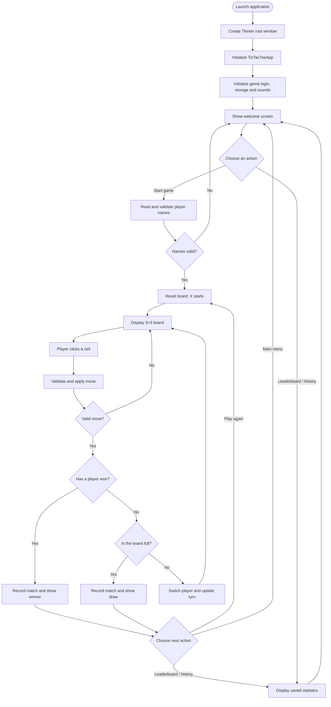

# Tic Tac Toe — Two Player Edition

A desktop Tic-Tac-Toe game for two players on the same computer, built with **Python** and **Tkinter**. Enter player names, take turns on a clickable 3×3 board, and keep track of wins and match history between sessions.

## Features

- **Two-player gameplay** — play locally with X and O on the same computer.
- **Player names** — enter a name for each player before starting.
- **Interactive 3×3 board** — make moves by clicking the cells.
- **Turn management** — automatically alternates between X and O.
- **Move validation** — prevents occupied cells from being selected.
- **Game result detection** — checks all rows, columns and diagonals for a win, and detects draws.
- **Multiple screens** — welcome, game, result, leaderboard and match-history screens.
- **Persistent statistics** — saves each player's games, wins and draws in a JSON file.
- **Leaderboard** — ranks players by wins, with games played as a secondary sorting key.
- **Sound effects** — sounds for entering the app, starting a match, winning and drawing. WAV files are generated locally; no audio downloads are required.

## Preview

The game uses a dark interface with separate welcome, gameplay, result and statistics screens.

## Tech Stack

| Technology | Purpose |
|---|---|
| Python | Application and game logic |
| Tkinter | Desktop GUI and button event handling |
| JSON | Persistent player statistics and match history |
| Python standard library | File handling, timestamps and sound generation/playback |

**Requirements:** Python 3.9+ and Tkinter. No third-party Python packages are required.

## Getting Started

### 1. Clone the repository

```bash
git clone https://github.com/SaketKumarp/tic-tac-toe-gui.git
cd tic-tac-toe-gui
```

### 2. Check Python and Tkinter

Check your Python version:

```bash
python --version
```

Tkinter is included with most standard Python installations. On some Linux distributions, install it separately:

```bash
sudo apt install python3-tk
```

### 3. Run the game

**Windows**

```powershell
py main.py
```

**macOS / Linux**

```bash
python3 main.py
```

If your system uses `python` for Python 3, you can also run:

```bash
python main.py
```

No dependency installation step is needed.

## How to Play

1. Launch the application.
2. Enter a name for Player X and Player O.
3. Select **Start Game**.
4. Players take turns clicking an empty cell. X always starts.
5. The game ends when a player gets three marks in a row, column or diagonal, or when all nine cells are filled.
6. From the result screen, choose **Play Again**, view the leaderboard and match history, or return to the main menu.

## Game Flow

The application is event-driven. Tkinter's `mainloop()` waits for user interaction; clicking a button invokes its callback. There is no separate loop continuously checking for moves.



## Project Structure

```text
tic-tac-toe-gui/
├── main.py
├── game/
│   ├── __init__.py
│   ├── logic.py
│   ├── storage.py
│   ├── sound.py
│   └── ui.py
├── requirements.txt
└── README.md
```

| File | Responsibility |
|---|---|
| `main.py` | Creates the Tkinter root window, starts the application and runs the event loop. |
| `game/ui.py` | Builds the screens and widgets, handles button clicks, and connects the UI to the game and storage layers. |
| `game/logic.py` | Maintains the board and current turn, validates moves, and detects wins and draws. |
| `game/storage.py` | Loads and saves player statistics and recent match records in JSON. |
| `game/sound.py` | Generates and plays the game's sound effects. |
| `requirements.txt` | Documents that no third-party packages are required. |

## How It Works

### Game logic

The board is represented by a list containing nine entries, one for each cell:

- An empty string means the cell is unoccupied.
- `"X"` or `"O"` means that player has selected the cell.
- The game checks eight winning combinations: three rows, three columns and two diagonals.
- After checking for a win, it checks whether all cells are occupied to identify a draw.
- The current player changes only after a valid move that does not end the game.

### User interface

The nine board buttons are created in a loop. Each button is assigned a position from 0 to 8, and its click callback passes that position to the move handler. The handler asks the game-logic class to validate and apply the move, then updates the interface based on the returned result.

### Persistent storage

The game creates `scores.json` in the project root after the first completed match. It stores:

- Per-player games played, wins and draws.
- Match details: both player names, result and timestamp.
- Up to the latest 100 match records.

Keep `scores.json` if you want to preserve your statistics. You can remove it to start with fresh statistics. The file is generated automatically and does not need to be created manually.

### Sound effects

Sound effects are generated as WAV files using Python's standard library and stored in the system temporary directory. Playback uses the available platform audio mechanism, with the Tkinter window bell as a fallback.

## Concepts Demonstrated

- Object-oriented programming and separation of responsibilities
- Tkinter windows, frames, labels, buttons and grid layout
- Event-driven programming and callback functions
- Lists, loops, conditionals and validation
- Win-condition checking and game-state management
- JSON serialization and file handling
- Basic sound generation and platform-dependent playback

## Future Improvements

- Add an option to reset saved statistics from within the application.
- Add configurable board sizes and game modes.
- Add automated tests for move validation, win detection and draw detection.

## License

No license has been specified for this repository yet.
